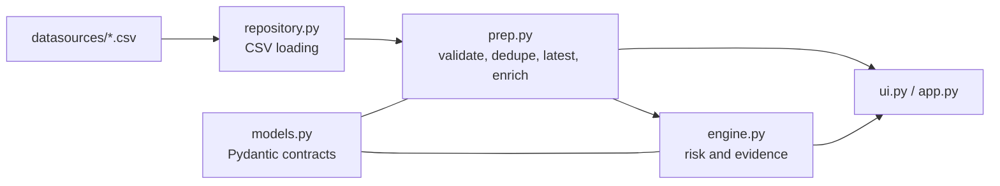

# Cycle 2 Reference Architecture

## Boundaries

- `repository.py` only loads sources and the scenario clock.
- `prep.py` owns data cleaning, validation, grouping, and enrichment.
- `engine.py` owns risk classification and evidence.
- `ui.py` renders; it does not calculate risk numbers.
- Dispatch is not part of this cycle.
- No module reads another branch or a prebuilt database.
