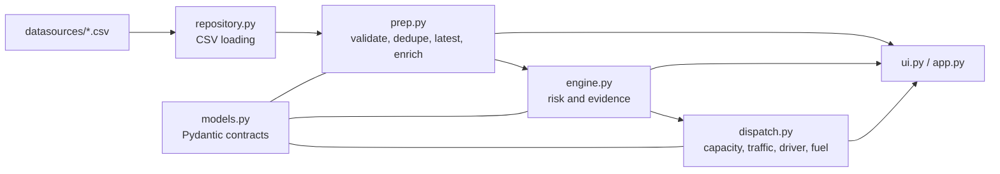

# Cycle 3 Reference Architecture

## Boundaries

- `repository.py` only loads sources and the scenario clock.
- `prep.py` owns data cleaning, validation, grouping, and enrichment.
- `engine.py` owns risk classification and evidence.
- `dispatch.py` owns deterministic feasibility and margin calculations.
- `ui.py` renders; it does not calculate risk or dispatch numbers.
- No module reads another branch or a prebuilt database.
